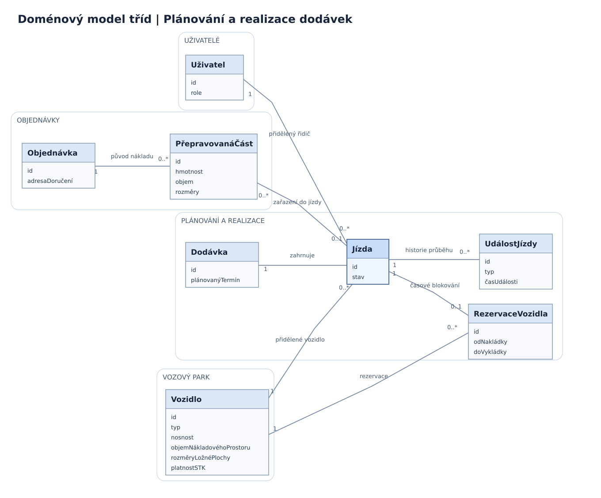

= Doménový model tříd – Plánování dodávek
:lang: cs
:toc:
:toc-title: Obsah
:toclevels: 2
:sectnums:
:revnumber: 1.0
:revdate: 2026-11-05

== Účel a rozsah

Doménový model popisuje klíčové objekty, údaje a vztahy informačního systému pro správu firemních vozidel a plánování dodávek zákaznických objednávek. Zachycuje přípravu nákladu, sestavení dodávek a jízd, přiřazení vozidel a řidičů, časové rezervace vozidel a záznam průběhu jízd.

Zákaznické objednávky a doručovací adresy pocházejí z existujícího interního systému. Nový systém tyto údaje využívá prostřednictvím jeho API. Model vyjadřuje doménové objekty a pravidla, nikoliv technické členění aplikace.

== Diagram tříd

Zdroj diagramu: link:../../diagrams/class/domain-class-model.puml[domain-class-model.puml].

== Doménové třídy

[cols="2,3,5",options="header"]
|===
|Třída |Klíčové údaje |Odpovědnost

|*Objednávka*
|ID, adresa doručení
|Zastupuje zdrojovou zákaznickou objednávku získanou z interního systému.

|*PřepravovanáČást*
|ID, hmotnost, objem, rozměry
|Vymezuje náklad nebo část nákladu původní objednávky zařazovanou do jízdy; zachovává vazbu na zdrojovou objednávku.

|*Dodávka*
|ID, plánovaný termín
|Vyjadřuje plánované doručení objednávek a propojuje je s realizovanými jízdami.

|*Jízda*
|ID, stav
|Eviduje konkrétní jízdu, přiřazeného řidiče, vozidlo a přepravovaný náklad; uchovává vazbu na historii událostí.

|*Vozidlo*
|ID, typ, nosnost, objem nákladového prostoru, rozměry ložné plochy, platnost STK
|Eviduje firemní osobní automobil nebo malou dodávku a údaje potřebné pro posouzení přepravní kapacity.

|*RezervaceVozidla*
|ID, začátek nakládky, konec vykládky
|Zachycuje časový interval použití vozidla při jízdě a umožňuje kontrolovat časové kolize.

|*Uživatel*
|ID, role
|Identifikuje interního uživatele systému. Ve vztahu k jízdě vystupuje uživatel s rolí řidiče.

|*UdálostJízdy*
|ID, typ, čas události
|Zachycuje úkony a průběh jízdy, uchovává historii a umožňuje jednoznačně identifikovat synchronizované události.
|===

== Vztahy a násobnosti

[cols="3,2,6",options="header"]
|===
|Vztah |Násobnost |Význam

|Objednávka – PřepravovanáČást
|+1 : 0..*+
|Každá přepravovaná část pochází z jedné původní objednávky. Objednávka může být rozdělena na více částí.

|PřepravovanáČást – Jízda
|+0..* : 0..1+
|Jízda přepravuje části více objednávek; jedna část se zařazuje nejvýše do jedné jízdy.

|Dodávka – Jízda
|+1+
|Jízda náleží k jedné plánované dodávce.

|Uživatel – Jízda
|+1 : 0..*+
|Přidělenou jízdu vykonává konkrétní řidič; řidič může mít více jízd.

|Vozidlo – Jízda
|+1 : 0..*+
|Jízdě je přiděleno konkrétní vozidlo. Vozidlo může být použito v různých jízdách.

|Vozidlo – RezervaceVozidla
|+1 : 0..*+
|Každá rezervace se vztahuje k jednomu vozidlu; vozidlo může mít více časových rezervací.

|Jízda – RezervaceVozidla
|+1 : 0..1+
|Rezervace časově blokuje vozidlo pro příslušnou jízdu.

|Jízda – UdálostJízdy
|+1 : 0..*+
|Každá událost patří jedné jízdě; jízda uchovává historii zaznamenaných událostí.
|===

== Pravidla konzistence

=== Objednávky a přepravní kapacita

* Údaje o objednávkách se získávají z existujícího interního systému, nikoliv opakovaným ručním založením nové zákaznické objednávky (FP-03).
* Jedna jízda může obsahovat náklad z více objednávek (FP-33).
* Jednu objednávku lze rozdělit do více jízd se zachováním vazby přepravovaných částí na původní objednávku (FP-34).
* Kapacita se posuzuje podle nákladu skutečně zařazeného do jízdy, včetně hmotnosti a rozměrů (FP-08).
* Překročení kapacity vozidla zabrání uložení příslušného plánu (FP-36).

=== Vozidla a rezervace

* Rezervace se vztahuje na vozidlo, nikoliv na řidiče. Pokrývá interval od zahájení nakládky do dokončení vykládky (FP-35).
* Dvě platné rezervace stejného vozidla se nesmějí časově překrývat ani při souběžném ukládání (FP-06, FP-07).
* Vozidlo obsahuje přepravní parametry a datum platnosti STK (FP-01, FP-02, FP-24).

=== Jízdy a události

* Automatické plánování vytváří jízdy a přiřazuje řidiče. Ruční změny plánu provádí pouze majitel (FP-30 až FP-32).
* Základní stavy jízdy jsou +Plánována+, +Na cestě+, +Dokončena+ a +Zrušena+. Příjezd a předání se zaznamenávají jako události průběhu.
* Zrušení jízdy je logické; záznam jízdy a její související historie zůstávají zachovány (FP-37).
* Události zaznamenané řidičem bez připojení se po obnovení připojení automaticky synchronizují bez duplicitního zápisu (FP-20, FP-21).
* Opožděná offline událost nesmí automaticky obnovit již zrušenou jízdu (FP-21, FP-37).
* Změnu stavu jízdy na cestě navrženou jiným oprávněným uživatelem lze uplatnit až po potvrzení řidičem (FP-38, FP-39).

== Vazba na procesy

[cols="2,5,4",options="header"]
|===
|Případ užití |Průběh |Dotčené třídy

|UC-01 – Naplánovat dodávky objednávek
|Systém načte objednávky, rozčlení přepravovaný náklad, sestaví jízdy, přiřadí řidiče a vozidla a vytvoří rezervace při dodržení kapacitních a časových omezení.
|Objednávka, PřepravovanáČást, Dodávka, Jízda, Vozidlo, RezervaceVozidla, Uživatel

|UC-02 – Upravit plán dodávek
|Majitel upraví plánované přiřazení. Systém opět ověří dostupnost a kapacitu vozidla a nepřípustnou změnu odmítne.
|Dodávka, Jízda, Vozidlo, RezervaceVozidla, PřepravovanáČást

|UC-07 – Zobrazit přidělené jízdy
|Řidič zobrazí své přidělené jízdy a doručovací údaje zdrojových objednávek a jejich částí.
|Uživatel, Jízda, Objednávka, PřepravovanáČást

|UC-08 – Zaznamenat stav jízdy
|Řidič zaznamená událost online nebo offline. Po přijetí systém událost vyhodnotí, zaznamená bez duplicit a zachová historii.
|Uživatel, Jízda, UdálostJízdy
|===

== Související dokumentace

* link:zadani.adoc[Zadání systému]
* link:katalog-pozadavku-v0.1.adoc[Katalog požadavků]
* link:slovnik-pojmu.adoc[Slovník pojmů]
* link:use-case-model.adoc[Model případů užití]
* link:specifikace-pripadu-uziti.adoc[Specifikace procesů]
