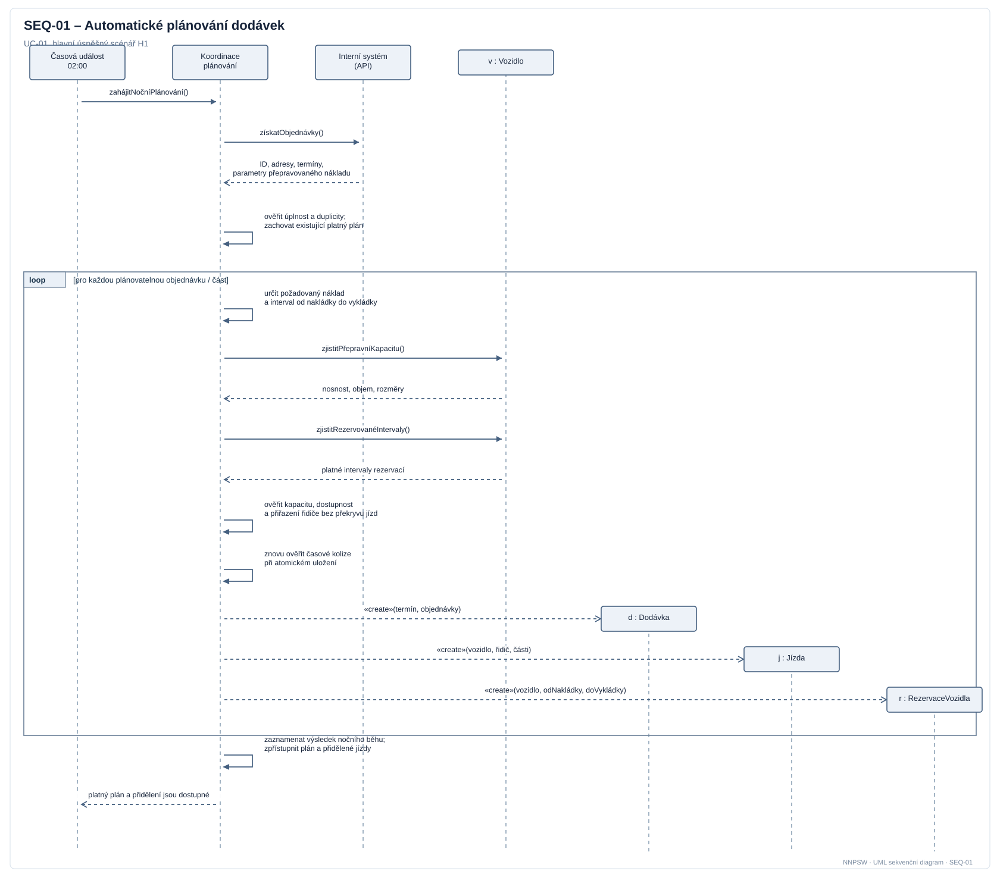
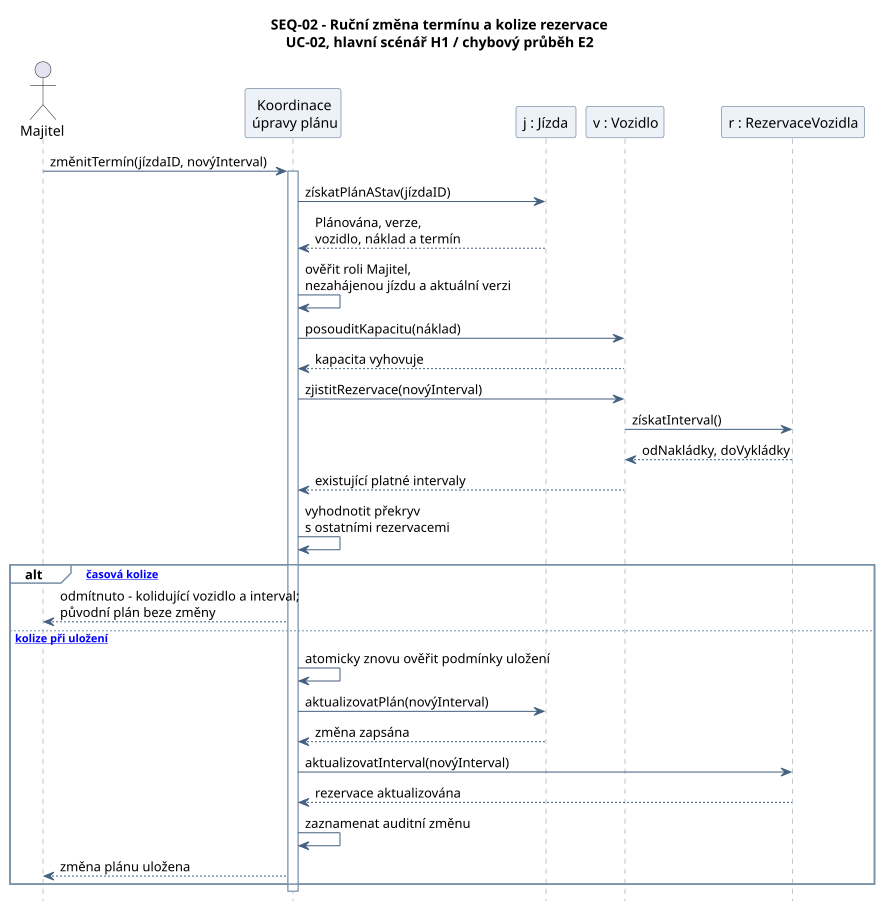
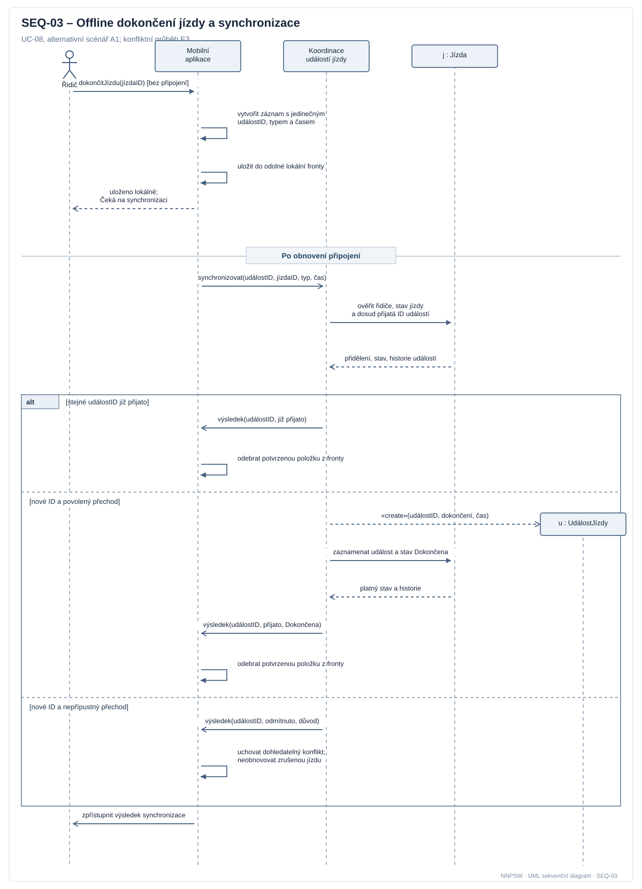

= Sekvenční diagramy – Plánování a realizace dodávek
:lang: cs
:toc:
:toc-title: Obsah
:toclevels: 2
:sectnums:
:revnumber: 1.0
:revdate: 2026-11-19

== Účel a východiska

Diagramy zachycují tři konkrétní průběhy již popsaných případů užití. Jde o *analytický pohled* podle cvičení 9: sledujeme pořadí zpráv, předávané informace a odpovědnosti účastníků, nikoliv technickou architekturu (kontrolery, databázové tabulky či síťové protokoly). Názvy existujících doménových objektů vycházejí z link:domenovy-model-trid.adoc[doménového modelu tříd].

[cols="1,3,3,3",options="header"]
|===
|Diagram |Scénář a vstup |Očekávaný výsledek |Vazba na požadavky

|SEQ-01
|UC-01 / H1. Ve 02:00 začíná automatické plánování nad dostupnými objednávkami.
|Po ověření údajů, kapacity, termínů a řidičů vzniknou přípustné dodávky, jízdy a rezervace.
|FP-03 až FP-08, FP-30, FP-31, FP-33 až FP-36

|SEQ-02
|UC-02 / H1 a E2. Majitel mění termín dosud nezahájené jízdy.
|Při časové kolizi je změna odmítnuta a původní plán zůstane platný; bez kolize lze změnu uložit.
|FP-06, FP-07, FP-08, FP-32, FP-35, FP-36

|SEQ-03
|UC-08 / A1, s relevantní odchylkou E3. Řidič offline zaznamená dokončení přidělené jízdy.
|Záznam čeká lokálně na synchronizaci; server jej přijme právě jednou, nebo vrátí dohledatelný konflikt.
|FP-16, FP-20, FP-21, FP-37; NFP-04
|===

== SEQ-01 – Automatické plánování dodávek

Zdroj: link:../../diagrams/sequence/sequence-uc-01.puml[sequence-uc-01.puml].

Sekvence zachycuje hlavní úspěšný průběh. Před vytvořením nových objektů se ověřují přepravní a časová omezení. Fragment *loop* odpovídá opakování nad zpracovávanými objednávkami nebo jejich částmi. Nepřípustné objednávky a chybu API popisují jiné průběhy UC-01; nejsou zde uměle doplněny jako další scénáře.

== SEQ-02 – Ruční změna termínu a kolize

Zdroj: link:../../diagrams/sequence/sequence-uc-02.puml[sequence-uc-02.puml].

Zaměřujeme se na změnu termínu při zachování vozidla. Fragment *alt* odděluje odmítnutí při kolizi od přípustného uložení. Jízda i její původní rezervace existují před začátkem sekvence; v chybové větvi se nemění ani nevytváří nový platný záznam. Jiné chyby z UC-02, zejména souběžná změna verze, zůstávají v textové specifikaci.

== SEQ-03 – Offline dokončení jízdy

Zdroj: link:../../diagrams/sequence/sequence-uc-08.puml[sequence-uc-08.puml].

Mobilní aplikace nejprve potvrdí pouze *lokální uložení*. Po obnovení spojení odešle událost asynchronně se stejným ID. Fragment *alt* rozlišuje opakovaně přijaté ID, novou přípustnou událost a nepřípustný přechod (např. po zrušení jízdy). Objekt +UdálostJízdy+ vzniká až po úspěšném ověření nové události.

== Zjištění a návazné ověření

* *N-01 – Názvosloví stavů:* Slovník pojmů uvádí příjezd a předání také mezi stavy jízdy, kdežto doménový model je chápe jako události +UdálostJízdy+. Pro sekvence používáme doménový model; slovník je vhodné při konsolidaci upravit.
* *O-05/O-06 – Stavový model a synchronizace:* Podrobná matice povolených přechodů a řešení konfliktů offline událostí zůstávají k dopracování. SEQ-03 nevytváří nové obchodní pravidlo a neobnovuje zrušenou jízdu.
* *O-12 – Plánování:* Výběr řidiče a konkrétní algoritmus rozdělení objednávek nejsou technicky předepsány. SEQ-01 zachycuje požadovanou odpovědnost bez zavedení další implementační třídy.

Při týmové kontrole je potřeba porovnat zprávy s aktuálními scénáři, ověřit tyto otevřené body a případné opravy promítnout zpět do související dokumentace.
