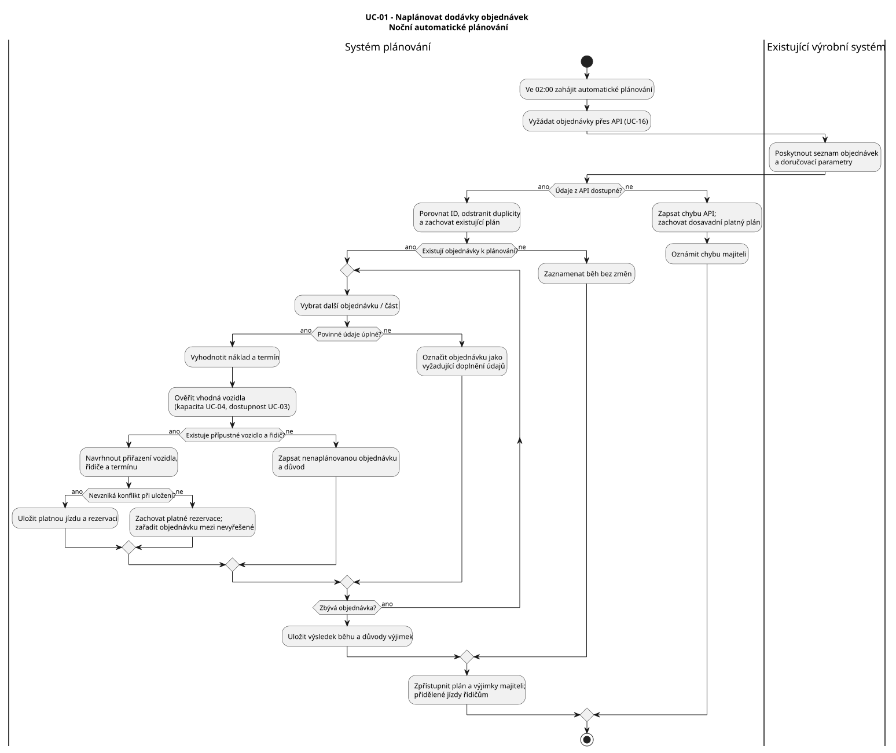
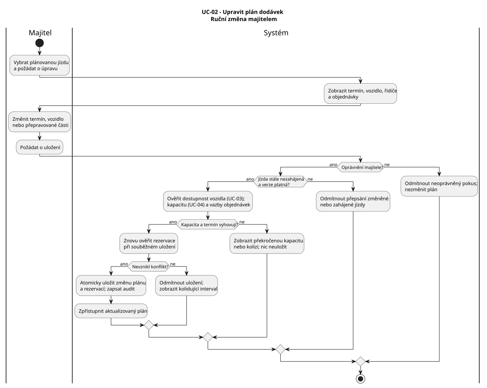
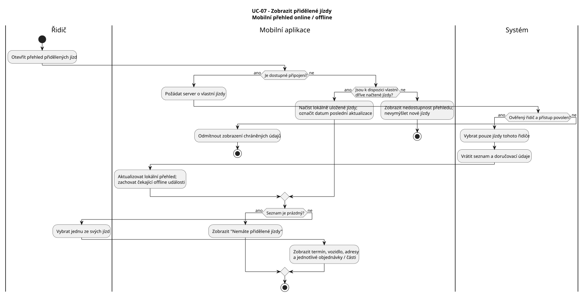
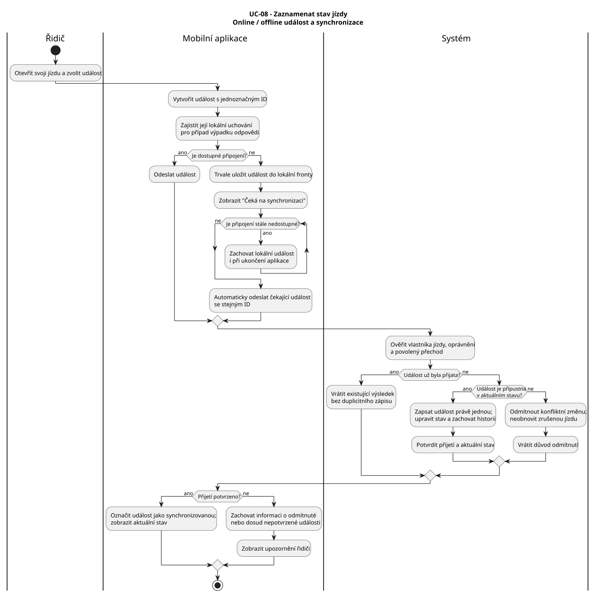

= Specifikace případů užití systému plánování dodávek
:lang: cs
:toc:
:toc-title: Obsah
:toclevels: 3
:sectnums:

== Účel a rozsah dokumentu

Dokument popisuje vybrané případy užití informačního systému pro správu firemních vozidel a plánování dodávek zákaznických objednávek. U jednotlivých případů užití stanovuje účel, účastníky, spouštěč, předpodmínky, hlavní a odchylné průběhy a výsledné podmínky. Součástí každé specifikace je odpovídající diagram aktivit.

Identifikátory případů užití a funkčních požadavků odpovídají xref:use-case-model.adoc[modelu případů užití] a xref:katalog-pozadavku-v0.1.adoc[katalogu požadavků]. Detailní provozní pravidla uvedená v této specifikaci tvoří podklad pro další zpřesnění návrhu systému.

== Přehled specifikovaných případů užití

[cols="1,3,5",options="header"]
|===
|ID |Případ užití |Význam
|UC-01 |Naplánovat dodávky objednávek |Automatické vytvoření plánu dodávek ze zdrojových objednávek při respektování dostupnosti a přepravní kapacity vozidel.
|UC-02 |Upravit plán dodávek |Ruční změna plánu majitelem s opětovnou kontrolou platnosti přiřazení a rezervací.
|UC-07 |Zobrazit přidělené jízdy |Zobrazení jízd a doručovacích údajů příslušnému řidiči v mobilní aplikaci.
|UC-08 |Zaznamenat stav jízdy |Zaznamenání průběhu jízdy včetně offline provozu a následné synchronizace.
|===

UC-03 (Ověřit dostupnost vozidla), UC-04 (Posoudit kapacitu vozidla) a UC-16 (Získat údaje objednávek) jsou podpůrnými případy užití plánování. UC-09 (Potvrdit navrženou změnu stavu jízdy) je samostatný případ užití pro potvrzování změn navržených jiným oprávněným uživatelem.

== Provozní pravidla

* R-01: Automatické plánování probíhá každý den ve 02:00 bez nutnosti ručního spouštění.
* R-02: Systém získává přes API existujícího výrobního systému objednávky a údaje potřebné pro jejich doručení. Struktura a provozní podmínky rozhraní budou stanoveny v integrační specifikaci.
* R-03: Majitel eviduje vozidla, jejich přepravní parametry a platnost STK a jako jediný ručně upravuje plán dodávek.
* R-04: Časová rezervace se vztahuje pouze na vozidlo a pokrývá interval od zahájení nakládky do dokončení poslední vykládky. Dva časově navazující nepřekrývající se intervaly nejsou konfliktní.
* R-05: Při vytvoření a změně jízdy se posuzuje dostupnost vozidla a přepravní kapacita podle hmotnosti, objemu a rozměrů nedělitelných položek. Překročení kapacity znemožní uložení daného přiřazení.
* R-06: Jedna jízda může zahrnovat více objednávek a jednu objednávku lze rozdělit do více jízd. Každá přepravovaná část zůstává dohledatelně navázána na zdrojovou objednávku.
* R-07: Řidič používá mobilní aplikaci a má přístup pouze ke svým přiděleným jízdám. Události zaznamenané bez připojení se po jeho obnovení automaticky synchronizují; opakované odeslání nevytváří duplicitní událost.
* R-08: Noční plánování zachovává již potvrzené ruční úpravy plánu. Objednávky, které nelze platně naplánovat, jsou vedeny samostatně s uvedením důvodu.
* R-09: Při přiřazení řidiče se přihlíží k jeho dosavadním jízdám tak, aby nevznikaly časové překryvy. Nevzniká samostatná evidence časových rezervací řidičů ani správa směn a dovolených.
* R-10: Základní stavy jízdy jsou `Plánována`, `Na cestě`, `Dokončena` a `Zrušena`. Příjezd a předání objednávky jsou zaznamenávané události. Zrušení je logické a zachovává historii jízdy.
* R-11: Změnu stavu probíhající jízdy navrženou majitelem musí před jejím uplatněním potvrdit řidič v UC-09. Vlastní události jízdy řidič zaznamenává v UC-08.

== UC-01 - Naplánovat dodávky objednávek

=== Identifikace a účel

[cols="1,4",options="header"]
|===
|Položka |Specifikace
|ID a název |UC-01 - Naplánovat dodávky objednávek
|Cíl |Z dostupných objednávek automaticky vytvořit přípustný plán doručení s vozidly, termíny a přidělenými řidiči.
|Primární příjemce hodnoty |Majitel (dostane hotový plán a přehled nevyřešených objednávek); UC se spouští časovou událostí.
|Podpůrný aktér |Existující interní výrobní systém (zdroj objednávek přes API).
|Spouštěč |Každý den ve 02:00 spustí časový plánovač nového Systému noční plánování.
|Předpodmínky |Systém disponuje evidencí vozidel, jejich kapacit a uživateli s rolí řidiče. Nevyžaduje se, aby objednávky byly předem platné: neúplné vstupy se ověřují během průběhu.
|Podpůrné UC |UC-16 Získat údaje objednávek; UC-03 Ověřit dostupnost vozidla; UC-04 Posoudit kapacitu vozidla.
|Vazba na požadavky |FP-03 až FP-08, FP-30, FP-31, FP-33 až FP-36; NFP-03, NFP-06; AK-FP-03 až AK-FP-08, AK-FP-30, AK-FP-31, AK-FP-33 až AK-FP-36.
|===

=== Hlavní úspěšný scénář H1

. *Systém:* V plánovaném čase zahájí noční běh a identifikuje ještě nezpracované nebo nově změněné objednávky.
. *Systém + výrobní systém:* Pomocí UC-16 přes API načte objednávky včetně ID, adres, požadovaných termínů a parametrů přepravovaných položek.
. *Systém:* Ověří úplnost požadovaných údajů, odstraní duplicity podle původního ID a respektuje již existující platný plán.
. *Systém:* Vybere další objednávku či její dosud nenaplánovanou část a určí její časové a kapacitní nároky.
. *Systém:* Najde vhodné vozidlo podle kapacity (UC-04), dostupnosti v požadovaném intervalu (UC-03) a možnosti spojení kompatibilních objednávek do jedné jízdy.
. *Systém:* Přiřadí řidiče podle dostupných přiřazení tak, aby navržené jízdy neměly pro stejného řidiče časový překryv. Samostatná rezervace řidiče nevzniká.
. *Systém:* Sestaví plánovanou dodávku a jízdu s vazbami na zdrojové objednávky nebo jejich části.
. *Systém:* Zopakuje kroky 4 až 7 pro zbývající objednávky; zkontroluje a atomicky uloží nově vzniklé rezervace tak, aby nevznikly dva platné překrývající se intervaly stejného vozidla.
. *Systém:* Zpřístupní plán majiteli v UC-05 a přidělené jízdy řidičům v UC-07. Uloží výsledek a záznam o nočním běhu.

=== Alternativní průběhy

* *A1 - Více objednávek v jedné jízdě (od kroku 5):* Systém ověří kompatibilní termíny a souhrnný náklad, spojí vhodné objednávky do jedné jízdy, zachová odkazy na jednotlivé objednávky a pokračuje krokem 6.
* *A2 - Objednávka rozdělená do více jízd (od kroku 4):* Náklad je rozdělitelný na samostatně evidované položky. Systém vytvoří více přepravovaných částí s vazbou na původní objednávku; každou část samostatně posoudí a naplánuje. Pokračuje krokem 5 pro další část.
* *A3 - Žádné nové objednávky (od kroku 3):* Systém zachová existující plán, zaznamená úspěšný běh bez změn a scénář skončí.
* *A4 - Část objednávek nelze naplánovat (od kroků 4 až 6):* Tyto objednávky označí jako `Nenaplánováno`, uvede konkrétní důvod a pokračuje zbývajícími objednávkami. Na konci zpřístupní majiteli plán spolu s nevyřešeným seznamem.

=== Chybové průběhy

* *E1 - API nedostupné nebo vrátí chybu (krok 2):* Systém zaznamená neúspěšný běh a oznámí problém majiteli. Již existující plán zůstane beze změny; žádný neúplný nový plán se neuloží. Běh končí.
* *E2 - Chybějí hmotnosti nebo rozměry (krok 3 nebo 5):* Systém označí dotčenou objednávku jako `Vyžaduje doplnění údajů`, nevytvoří pro ni nepodloženou rezervaci a pokračuje další objednávkou. Následně je požadována náprava zdrojových dat.
* *E3 - Překročená kapacita / nedostupné vozidlo (krok 5):* Systém zkusí další přípustnou variantu. Pokud neexistuje, objednávku nezařadí a zapíše konkrétní důvod.
* *E4 - Konflikt vzniklý při souběžném uložení (krok 8):* Systém nesmí uložit dvě kolidující platné rezervace. Kolizní část přehodnotí nebo ji přesune mezi nevyřešené objednávky; ostatní nekolidující části mohou být uloženy.

=== Výsledné podmínky

* *Úspěch:* Nové platné jízdy a vozidla jsou přiřazeny bez kapacitních a časových konfliktů; plán je dohledatelný pro majitele a řidiče.
* *Částečný úspěch:* Platné části plánu jsou uloženy; nenaplánované objednávky a důvody jsou zobrazeny majiteli.
* *Neúspěch:* Při chybě API nevznikne nový plán, původní platné záznamy zůstanou zachovány.

=== Doplňující pravidla

* Při souběžném ukládání nesmějí vzniknout dvě platné rezervace téhož vozidla v překrývajícím se intervalu (FP-07).
* Při překročení kapacity vozidla se pro dotčený náklad nevytvoří platné přiřazení; důvod zůstává dohledatelný (FP-36).
* Plánování vytváří přiřazení vozidel a řidičů automaticky; nenaplánované objednávky se zobrazují majiteli s důvodem (FP-30, FP-31).
* Podrobnosti výběru řidičů, rozdělování objednávek a datového rozhraní upřesňují navazující pravidla plánování a integrace.

=== Activity diagram UC-01

Zdroj: link:../../diagrams/activity/activity-uc-01.puml[activity-uc-01.puml].

== UC-02 - Upravit plán dodávek

=== Identifikace a účel

[cols="1,4",options="header"]
|===
|Položka |Specifikace
|ID a název |UC-02 - Upravit plán dodávek
|Cíl |Oprávněně a bezpečně změnit uložený plán dodávek bez konfliktu vozidel či překročení kapacity.
|Primární aktér |Majitel.
|Spouštěč |Majitel v přehledu vybere plánovanou dodávku a požádá o úpravu.
|Předpodmínky |Majitel je přihlášen a je k dispozici uložený plán. To, zda jízda ještě nezačala, se ověřuje až při provádění UC.
|Podpůrné UC |UC-03 Ověřit dostupnost vozidla; UC-04 Posoudit kapacitu vozidla.
|Vazba na požadavky |FP-04 až FP-08, FP-32 až FP-36; NFP-03; AK-FP-05 až AK-FP-08, AK-FP-32 až AK-FP-36.
|===

=== Hlavní úspěšný scénář H1

. *Majitel:* Otevře přehled plánovaných dodávek a zvolí nezahájenou jízdu.
. *Systém:* Zobrazí dosavadní termín, přiřazené vozidlo, řidiče a objednávky nebo jejich části.
. *Majitel:* Změní plánovaný termín, vozidlo nebo přiřazení objednávek či přepravovaných částí a požádá o uložení.
. *Systém:* Ověří oprávnění majitele, aktuální verzi záznamu a skutečnost, že jízda ještě nezačala.
. *Systém:* Pro výsledné přiřazení znovu ověří časovou dostupnost vozidla (UC-03) a jeho kapacitu (UC-04), i když se vozidlo nezměnilo.
. *Systém:* Před uložením ověří, že nedojde ke konfliktu žádné jiné platné rezervace a odkazy na všechny objednávky a jejich části zůstanou zachovány.
. *Systém:* Atomicky uloží přípustnou změnu, aktualizuje rezervace a zaznamená auditní záznam.
. *Systém:* Zpřístupní upravený plán majiteli a aktuální přiřazení příslušnému řidiči.

=== Alternativní průběhy

* *A1 - Změna pouze termínu (krok 3):* Majitel změní časový interval, vozidlo ponechá. Krok 5 stále zkontroluje dostupnost a kapacitu výsledného plánu.
* *A2 - Přiřazení jiného vozidla (krok 3):* Majitel zvolí jiný automobil. Systém vyhodnotí jeho nosnost, objem, rozměry a obsazenost a pokračuje krokem 6 pouze tehdy, pokud vyhoví.
* *A3 - Přesunutí části objednávky (krok 3):* Majitel přesune vymezenou přepravovanou část do jiné nezahájené jízdy. Systém ověří obě výsledné jízdy a atomicky upraví jejich rezervace; původ objednávky zůstane dohledatelný.

=== Chybové průběhy

* *E1 - Neoprávněná role (krok 4):* Pokud úpravu zkusí dělník nebo řidič, systém ji odmítne a neprovede žádnou změnu (AK-FP-32; NFP-03).
* *E2 - Kolize rezervací (kroky 5 až 6):* Systém popíše kolidující vozidlo a interval; změnu neuloží a nabídne návrat ke kroku 3.
* *E3 - Překročená kapacita (krok 5):* Systém zobrazí porušený parametr, například `nosnost 800 kg, náklad 1 000 kg`; změnu neuloží a vrátí majitele ke kroku 3.
* *E4 - Mezitím změněný nebo zahájený plán (krok 4):* Systém odmítne přepsat novější stav, nabídne znovunačtení a případné opakování od kroku 1. Změny již zahájené jízdy touto službou nepovolí.

=== Výsledné podmínky

* *Úspěch:* Je uložena právě jedna aktuální verze plánu; zůstává splněna dostupnost a kapacita vozidel, změna je auditovatelná.
* *Neúspěch:* Poslední platná verze plánu a rezervací zůstává zachována, uživatel zná důvod odmítnutí.

=== Doplňující pravidla

* Ruční změnu plánu může provést pouze majitel; nepřípustné požadavky jiných rolí se odmítnou (FP-32, NFP-03).
* Před uložením změny se znovu ověřuje časová dostupnost i přepravní kapacita vozidla (FP-07, FP-36).
* Změna stavu probíhající jízdy navržená majitelem podléhá samostatnému potvrzení řidičem v UC-09.

=== Activity diagram UC-02

Zdroj: link:../../diagrams/activity/activity-uc-02.puml[activity-uc-02.puml].

== UC-07 - Zobrazit přidělené jízdy

=== Identifikace a účel

[cols="1,4",options="header"]
|===
|Položka |Specifikace
|ID a název |UC-07 - Zobrazit přidělené jízdy
|Cíl |Umožnit řidiči zjistit vlastní jízdy a informace potřebné pro doručení.
|Primární aktér |Řidič (mobilní aplikace).
|Spouštěč |Řidič otevře seznam přidělených jízd.
|Předpodmínky |Řidič je ověřený uživatel; pro offline scénář musí být potřebná data dříve načtena.
|Vazba na požadavky |FP-11, FP-12, FP-31, FP-33, FP-34; NFP-02, NFP-03, NFP-07; AK-FP-11, AK-FP-12.
|===

=== Hlavní úspěšný scénář H1

. *Řidič:* V mobilní aplikaci otevře přehled svých jízd.
. *Mobilní aplikace:* Při dostupném připojení požádá centrální systém o aktuální jízdy ověřeného řidiče.
. *Systém:* Ověří identitu a oprávnění a vybere výhradně jízdy přidělené danému řidiči.
. *Systém:* Vrátí seznam jízd s termíny, vozidlem a základním stavem a odpovídající doručovací údaje jednotlivých objednávek.
. *Mobilní aplikace:* Bez ztráty dosud neodeslaných lokálních událostí aktualizuje dostupná data pro případný offline provoz.
. *Řidič:* Vybere konkrétní jízdu.
. *Mobilní aplikace:* Zobrazí detail s adresami doručení a jednotlivými objednávkami nebo přepravovanými částmi.

=== Alternativní průběhy

* *A1 - Řidič nemá přidělené jízdy (od kroku 4):* Systém vrátí prázdný seznam; aplikace zobrazí informaci `Nemáte přidělené jízdy`. Scénář úspěšně končí.
* *A2 - Připojení není dostupné (od kroku 2):* Aplikace zobrazí dříve načtené vlastní jízdy, datum poslední aktualizace a upozornění na možné zastarání dat. Řidič pokračuje krokem 6.
* *A3 - Jedna jízda má více objednávek (krok 7):* Aplikace ukáže všechny přiřazené adresy a položky podle objednávek; nepovažuje je za samostatné účty zákazníků.

=== Chybové průběhy

* *E1 - Bez připojení a bez lokálních dat (krok 2):* Aplikace zobrazí vysvětlení, že seznam zatím nelze načíst; žádné fiktivní jízdy nevytvoří.
* *E2 - Neplatné ověření (krok 3):* Systém odmítne přístup k chráněným údajům; aplikace vyžádá nové přihlášení.
* *E3 - Pokus o přístup k cizí jízdě (krok 3 nebo 7):* Systém odmítne požadavek bez poskytnutí cizích doručovacích údajů.
* *E4 - Dočasná chyba služby (krok 2):* Aplikace informuje řidiče a může nabídnout vlastní dříve uložené jízdy s upozorněním na jejich stáří.

=== Výsledné podmínky

* *Úspěch:* Řidič má k dispozici pouze své přidělené jízdy a údaje potřebné pro doručení; data jsou připravena pro podporované offline úkony.
* *Neúspěch:* Cizí údaje nebyly zpřístupněny; poslední lokální záznamy o událostech nejsou ztraceny.

=== Doplňující pravidla

* Seznam jízd obsahuje pouze přiřazení přihlášeného řidiče; přístup k údajům cizí jízdy se odmítne (NFP-03).
* Detail každé jízdy poskytuje doručovací údaje ke všem zahrnutým objednávkám a jejich přepravovaným částem (FP-11, FP-12).
* Offline zobrazení vychází z dříve načtených údajů a musí rozlišovat jejich případnou neaktuálnost.

=== Activity diagram UC-07

Zdroj: link:../../diagrams/activity/activity-uc-07.puml[activity-uc-07.puml].

== UC-08 - Zaznamenat stav jízdy

=== Identifikace a účel

[cols="1,4",options="header"]
|===
|Položka |Specifikace
|ID a název |UC-08 - Zaznamenat stav jízdy
|Cíl |Umožnit řidiči zapsat událost své jízdy online nebo offline tak, aby výsledek byl později dostupný v centrálním systému.
|Primární aktér |Řidič (mobilní aplikace).
|Spouštěč |Řidič v detailu své přidělené jízdy zvolí akci, např. zahájení, příjezd, předání, dokončení nebo zrušení.
|Předpodmínky |Řidič je ověřený a jízda mu byla přiřazena a dříve zpřístupněna. Dostupnost internetu *není* předpodmínkou.
|Související samostatný UC |UC-09 Potvrdit navrženou změnu stavu jízdy (pouze změna navržená jiným oprávněným aktérem).
|Vazba na požadavky |FP-13 až FP-17, FP-20, FP-21, FP-37; NFP-02, NFP-03, NFP-04, NFP-07; pro související změny navíc omezení FP-38, FP-39.
|===

=== Hlavní úspěšný scénář H1 - online

. *Řidič:* Otevře svoji přidělenou jízdu.
. *Mobilní aplikace:* Zobrazí stav jízdy a dostupné úkony.
. *Řidič:* Vybere událost (například `Zahájit jízdu`, `Zaznamenat příjezd`, `Potvrdit předání objednávky` nebo `Dokončit jízdu`).
. *Mobilní aplikace:* Vytvoří požadavek s jednoznačným identifikátorem události, bezpečně si jej uloží pro případ přerušení spojení a odešle jej serveru.
. *Systém:* Ověří přiřazení řidiče, aktuální stav a povolenost vybrané události. U předání ověří vazbu na konkrétní objednávku nebo přepravovanou část.
. *Systém:* Zapíše událost právě jednou, aktualizuje příslušný stav a zachová historické záznamy a logy. Při zrušení nevykoná fyzické odstranění jízdy.
. *Systém:* Vrátí výsledek s aktuálním stavem.
. *Mobilní aplikace:* Zobrazí potvrzení a aktuální údaje řidiči.

=== Alternativní průběhy

* *A1 - Úplný offline průběh (od kroku 4):* Aplikace ověří lokálně dostupná pravidla, uloží událost s ID do odolné lokální fronty a zobrazí stav `Čeká na synchronizaci`. Po obnově spojení sama odešle čekající události. Systém je ověří a potvrdí; aplikace odstraní úspěšně převzaté položky z fronty a aktualizuje údaje.
* *A2 - Příjezd a předání více objednávek (krok 3):* Řidič zaznamená příjezd a předání pro konkrétní objednávky či jejich části; události lze v jedné jízdě opakovat, aniž by se pro každou vytvářel nový UC.
* *A3 - Zrušení jízdy (krok 3):* Řidič zvolí zrušení, uvede důvod. Systém po ověření přípustnosti přejde do stavu `Zrušena` a zachová historii i logy. Další změny zrušené jízdy nejsou automaticky povoleny.
* *A4 - Ztráta spojení při odesílání (kroky 4 až 7):* Aplikace ponechá požadavek se stejným ID ve frontě. Po obnově připojení jej odešle znovu; systém jej rozpozná a nezapíše duplicitně.

=== Chybové průběhy

* *E1 - Nedovolená změna stavu (krok 5):* Systém změnu odmítne, sdělí důvod a nezmění centrální stav.
* *E2 - Jízda patří jinému řidiči (krok 5):* Systém odmítne operaci; neposkytne údaje cizí jízdy.
* *E3 - Offline událost je v konfliktu s novým serverovým stavem (krok 5 po A1):* Například jízda byla platně zrušena. Systém nesmí starší změnou jízdu obnovit, konflikt eviduje a oznámí jej řidiči a majiteli k vyřešení. Lokální událost se nesmaže bez dohledatelného výsledku.
* *E4 - Selhání serveru (kroky 4 až 7):* Lokální požadavek zůstane označen jako nepotvrzený a aplikace zopakuje synchronizaci později; před potvrzením nesmí hlásit centrální úspěch.

=== Výsledné podmínky

* *Úspěch online:* Platná událost je zapsána v centrálním systému jednou, je dohledatelný stav a auditní historie.
* *Úspěch offline (lokální):* Událost je bezpečně uložena v telefonu jako `Čeká na synchronizaci`; po synchronizaci je potvrzena centrálně.
* *Neúspěch:* Nepřípustná změna není provedena; konflikt je identifikován a událost není ztracena bez informace o jejím osudu.

=== Doplňující pravidla

* Zahájení, příjezd, předání, dokončení a přípustné zrušení představují různé průchody jedním případem užití (FP-13 až FP-17).
* Offline událost musí zůstat zachována do zpracování; po obnovení připojení probíhá synchronizace automaticky (FP-20, FP-21).
* Zrušená jízda zůstává v historii a opožděná offline událost ji nesmí sama obnovit (FP-37).
* Povolené přechody stavů a povinné údaje při zrušení jsou součástí navazujícího stavového modelu.

=== Activity diagram UC-08

Zdroj: link:../../diagrams/activity/activity-uc-08.puml[activity-uc-08.puml].

