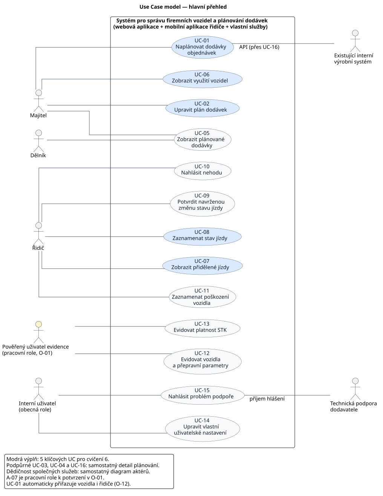
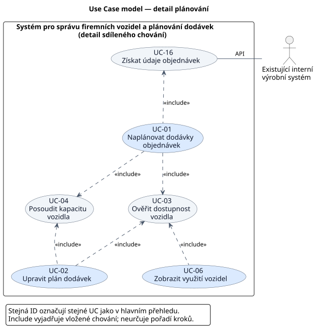
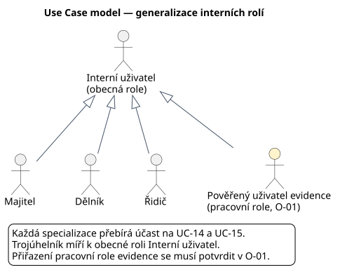

= Use Case model systému plánování dodávek
Oleksandr Mytro
:lang: cs
:toc:
:toc-title: Obsah
:toclevels: 2
:sectnums:
:revnumber: 0.3
:revdate: 2026-10-29
:source-highlighter: highlight.js
:repo: https://github.com/ku3m0v/nnpsw-delivery-planning
:baseline: 84233eaf35a0d2e4d46027b2a7e392191e2d8d4c

== Účel, podklady a stav

Model zachycuje vnější role, jejich cíle a hranici nového Systému pro správu firemních vozidel a plánování dodávek.
Navazuje na cvičení 5; úplné specifikace, scénáře a activity diagramy vybraných UC jsou předmětem cvičení 6.

Podklady:

* xref:zadani.adoc[Zadání semestrální práce].
* xref:katalog-pozadavku-v0.1.adoc[Katalog požadavků v0.1], včetně upřesnění U01 až U10 a otevřených otázek O-01 až O-12.
* xref:slovnik-pojmu.adoc[Existující slovník pojmů] jako terminologický podklad; zjištěné rozpory jsou uvedeny níže.
* Prezentace `NNPSW_cv05_use_case_diagram.pdf`, zejména snímky 12-18 (aktéři, hranice a cíle), 20-27 (vztahy), 33 (postup), 37 (pokrytí), 39 (výběr) a 41-44 (kontrola a výstupy).

Výchozí revize podkladů: `{baseline}`.
Stav: *pracovní model k validaci týmem a zadavatelem*.
Review: *čeká na kontrolu jiným členem týmu než autorem*.
Katalog je nadále návrhem k validaci; tento dokument neprohlašuje jeho priority, oprávnění ani otevřená pravidla za schválená.
Při zpřesnění původního zadání se model řídí aktuálním katalogem a jeho zdrojově doloženými doplněními.

== Aktéři a důvod interakce

Aktér je vnější role vůči analyzovanému softwaru. I zaměstnanec firmy tedy stojí v diagramu vně hranice Systému.

[cols="1,2,5,3",options="header"]
|===
|ID |Aktér |Role, cíl a důvod interakce |Podklad

|A-01
|Majitel
|Ve webové aplikaci získává přehled o dodávkách a využití vozidel. Je příjemcem automaticky vytvořeného plánu a jako jediný smí plán ručně upravovat. Účast na automatickém plánování neznamená, že je již určeno jeho ruční spouštění.
|FP-04, FP-09, FP-10, FP-30, FP-32; O-12.

|A-02
|Řidič
|V mobilní aplikaci zjišťuje přidělené jízdy a doručovací údaje, zaznamenává průběh jízdy, nehody a poškození. Dostává oznámení navržené změny stavu a tuto změnu potvrzuje. Vymezené úkony provádí i offline.
|FP-11 až FP-21, FP-28, FP-38, FP-39; NFP-02, NFP-04, NFP-07.

|A-03
|Dělník
|Ve webové aplikaci získává informace o připravovaných a plánovaných dodávkách v rozsahu svých oprávnění. Není mu přiřazeno právo ručně měnit plán, přidělovat vozidla nebo evidovat STK.
|FP-22, FP-32; NFP-03; O-01.

|A-04
|Existující interní výrobní systém
|Podpůrný externí systém poskytující přes API seznam objednávek a údaje potřebné pro doručení. Zůstává zdrojem objednávek a adres; není součástí nového Systému.
|FP-03; zadání, oddíl Existující interní systém; O-04.

|A-05
|Technická podpora dodavatele
|Podpůrný aktér přijímající hlášení problémů z webové i mobilní aplikace. Příjem je konkrétní interakce; přímé přihlášení podpory, správa ticketů či jejich řešení v novém Systému nejsou požadovány.
|FP-27 až FP-29; O-09.

|A-06
|Interní uživatel
|Obecná role pro společné služby: vlastní nastavení a hlášení problému. Specializace Majitel, Dělník, Řidič a pracovní role A-07 dědí pouze tyto společné asociace. Nejde o další samostatnou pracovní pozici ani o přístup ke všem funkcím.
|FP-23, FP-27, FP-28; NFP-03.

|A-07
|Pověřený uživatel evidence
|*Pracovní analytická role, jejíž obsazení se musí potvrdit v O-01.* Zachycuje oprávněného zaměstnance, který eviduje vozidla, přepravní parametry a platnost STK. Potřeba této interakce je doložena; není určeno, zda ji bude vykonávat majitel, dělník nebo jinak pověřený zaměstnanec. Model nezavádí nový povinný typ účtu.
|FP-01, FP-02, FP-24; O-01.
|===

Zákazník nábytkářské firmy není aktérem: nemá uživatelský přístup ani požadovanou přímou interakci s novým Systémem. Jeho adresa je údajem poskytovaným interním systémem, nikoli důvodem pro zákaznický účet.
Automatický plánovač, API jako rozhraní, databáze, mobilní aplikace a synchronizační mechanismus nejsou vnější aktéři; patří k chování nebo vnitřním částem Systému.
Není zaváděn aktér Hodiny ani externí plánovací služba, protože spouštění automatizace dosud není určeno.

== Hranice a rozsah Systému

=== Uvnitř hranice

Hranice nese název *Systém pro správu firemních vozidel a plánování dodávek* a zahrnuje webovou aplikaci, mobilní aplikaci řidiče a vlastní služby nového řešení.

* Získání a využití údajů objednávek přes API; vazby plánu na zdrojové objednávky a případné přepravované části.
* Automatické sestavení plánu a přidělení jízd řidičům; oprávněné ruční změny plánu majitelem.
* Přiřazení vozidel, rezervace od naložení do vyložení, kontrolu časové dostupnosti, prevenci konfliktů a posouzení kapacity včetně blokování překročení.
* Přehled dodávek, využití vozidel a přidělených jízd podle oprávnění.
* Záznam stavů jízdy, potvrzování navržené změny řidičem, nehody a poškození; vymezenou offline práci a automatickou synchronizaci.
* Evidenci vozidel, jejich přepravních parametrů a termínů STK, uchování historie a souvisejících logů.
* Vlastní uživatelská nastavení a přijetí i předání hlášení podpoře.

Jádrem první etapy je plánování dodávek, vhodnost vozidel a prevence konfliktů. Hlavní diagram zachycuje všechny uživatelské cíle; sdílené podpůrné chování rozvádí detail plánování. Diagramy neznamenají, že všechny služby již byly schváleny pro první etapu. Etapové zařazení včetně automatizace zůstává v O-11.

=== Vně hranice a mimo rozsah

[cols="2,5",options="header"]
|===
|Oblast |Vymezení
|Interní výrobní systém |Výroba, primární evidence objednávek a zákaznických adres a poskytující strana API zůstávají v existujícím systému. Nové řešení tyto záznamy ručně nezakládá jako druhou zákaznickou evidenci. Technická mezipaměť nebo vazba na zdrojový záznam nejsou vyloučeny (FP-03).
|Zákazník a fyzické doručení |Zákazník nemá přístup do B2E řešení. Fyzická přeprava, naložení, vyložení a předání probíhají mimo software; Systém je plánuje nebo zaznamenává jejich události.
|Technická podpora |Převzetí hlášení je vnější spolupráce. Vlastní řešení problému, přihlášení podpory a nový ticketovací portál nejsou odvozeny.
|Ostatní vyloučené činnosti |Montáž nábytku, další servis a údržba, personální evidence oprávnění a prohlídek řidičů, směn, dovolených a nemocenských.
|Nepotvrzené rozšíření |Detailní rozmístění nákladu ve vozidle. Dále se bez podkladu nepřidává optimalizace tras, navigace, GPS sledování, fakturace, rezervace řidičů ani automatický zákaz použití vozidla kvůli STK.
|===

=== Spolupráce přes API

UC-16 představuje chování nového Systému: získat potřebné údaje. Aktér A-04 představuje jejich vnějšího poskytovatele.
V detailu plánování asociace označená `API` spojuje UC-16 s poskytujícím systémem a překračuje hranici Systému. Hlavní přehled tuto spolupráci souhrnně spojuje s UC-01 a popiskem `API (přes UC-16)`; nejde o další integraci. Rozhraní samo není dalším aktérem ani samostatnou aplikací v hranici.
Model nevyžaduje zpětný zápis objednávek nebo stavů do interního systému, protože takový požadavek není doložen.
Kontrakt, aktuálnost, výpadky a původ přepravních parametrů se musí doplnit v O-04.

== Přehled případů užití

Názvy vyjadřují infinitiv a předmět činnosti. Model obsahuje 13 uživatelských cílů a 3 podpůrné UC.
Podpůrné UC-03, UC-04 a UC-16 jsou záměrně jemnější: jde o vyčleněné chování zahrnuté pomocí `include`, obdobně jako ověření údajů v prezentaci.

[cols="1,3,2,5,3",options="header"]
|===
|ID |Název |Účast |Pozorovatelný výsledek a význam |Požadavky

|[[UC-01]]UC-01
|Naplánovat dodávky objednávek
|Majitel jako příjemce výsledku; nepřímo A-04 přes UC-16.
|Pro přípustné vstupy vznikne automaticky plán dodávek s vozidly, termíny a přidělenými řidiči. Zahrnuje více objednávek v jízdě a rozdělení objednávky se zachováním vazeb. Spouštění a výběrová pravidla nejsou určeny (O-12).
|FP-04, FP-05, FP-30, FP-31, FP-33 až FP-35; vložené UC-03, UC-04, UC-16.

|[[UC-02]]UC-02
|Upravit plán dodávek
|Majitel.
|Přípustná ruční změna plánu se uloží, včetně případné změny přiřazeného vozidla, termínu nebo zařazení objednávek či jejich částí. Řidič ani dělník tuto službu použít nesmějí. I změna ponechávající původní vozidlo musí respektovat dostupnost a kapacitu.
|FP-04, FP-05, FP-32 až FP-35; vložené UC-03 a UC-04; NFP-03.

|[[UC-03]]UC-03
|Ověřit dostupnost vozidla
|Podpůrný UC pro UC-01, UC-02 a UC-06.
|Je známá dostupnost vozidla pro požadovaný interval od naložení do vyložení. Při ukládání plánu nesmí vzniknout dvě platné kolidující rezervace ani při souběhu. Kontrola v přehledu sama nic nerezervuje a nenahrazuje kontrolu při uložení.
|FP-06, FP-07, FP-35.

|[[UC-04]]UC-04
|Posoudit kapacitu vozidla
|Podpůrný UC pro UC-01 a UC-02.
|Je vyhodnocena kapacita pro skutečný náklad dané jízdy. Při překročení systém upozorní a zablokuje uložení plánu. Nezavádí se detailní rozmístění nákladu; pravidla pro rozměry, objem a chybějící data zůstávají otevřená.
|FP-08, FP-36; využívá FP-02, FP-33, FP-34.

|[[UC-05]]UC-05
|Zobrazit plánované dodávky
|Majitel, dělník.
|Majitel získá přehled termínů a přiřazených vozidel; dělník získá údaje o připravovaných a plánovaných dodávkách podle oprávnění. Společný název neznamená totožná oprávnění obou rolí (O-01).
|FP-09, FP-22; NFP-03.

|[[UC-06]]UC-06
|Zobrazit využití vozidel
|Majitel.
|Majitel ve zvoleném termínu rozliší dostupná a již přiřazená vozidla. Dostupnost se vyhodnotí pomocí UC-03. Samotná časová dostupnost ještě nepotvrzuje dostatečnou kapacitu.
|FP-10; vložený UC-03.

|[[UC-07]]UC-07
|Zobrazit přidělené jízdy
|Řidič.
|Řidič získá seznam vlastních přidělených jízd i jejich základní doručovací údaje, včetně adres příslušných objednávek. Seznam a detail jsou součásti jednoho cíle připravit se na jízdu.
|FP-11, FP-12; NFP-02.

|[[UC-08]]UC-08
|Zaznamenat stav jízdy
|Řidič.
|Řidič zaznamená zahájení, příjezd, předání, dokončení nebo přípustné zrušení své jízdy. Jednotlivé události jsou různé průchody jednoho UC, nikoli šipkami předepsané pořadí. Zrušení zachová záznam i související logy.
|FP-13 až FP-17, FP-37; pravidla FP-20, FP-21 a FP-39.

|[[UC-09]]UC-09
|Potvrdit navrženou změnu stavu jízdy
|Řidič.
|Řidič obdrží oznámení návrhu jiného oprávněného účastníka během jízdy a může navržený přípustný stav výslovně potvrdit. Bez jeho potvrzení se návrh neuplatní. Konkrétní role navrhovatele ani reakce na odmítnutí či neodpovězení nejsou tímto modelem rozhodnuty.
|FP-38, FP-39; O-01, O-05, O-06.

|[[UC-10]]UC-10
|Nahlásit nehodu
|Řidič.
|U přidělené jízdy je evidováno hlášení nehody. Nejde o hlášení technické chyby aplikace a není odvozen kontakt s pojišťovnou či policií.
|FP-18; pravidla FP-20, FP-21.

|[[UC-11]]UC-11
|Zaznamenat poškození vozidla
|Řidič.
|Nové poškození, včetně poškození zjištěného po příjezdu, je zaznamenáno u vozidla bez ztráty starších záznamů a se souvisejícím logem.
|FP-19, FP-25, FP-26; pravidla FP-20, FP-21.

|[[UC-12]]UC-12
|Evidovat vozidla a přepravní parametry
|Pověřený uživatel evidence; pracovní role A-07.
|Oprávněný uživatel uloží a zobrazí evidenci osobních automobilů a malých dodávek s objemem, nosností a rozměry. Konkrétní nositel role není určen (O-01). Není přidána likvidace vozidla ani obecná servisní agenda.
|FP-01, FP-02.

|[[UC-13]]UC-13
|Evidovat platnost STK
|Pověřený uživatel evidence; pracovní role A-07.
|Oprávněný uživatel uloží a zobrazí termín platnosti STK u vozidla. Bez potvrzeného požadavku se nepřidává upozornění na blížící se STK ani zákaz plánování po jejím uplynutí.
|FP-24; O-01.

|[[UC-14]]UC-14
|Upravit vlastní uživatelské nastavení
|Interní uživatel a jeho specializace.
|Uživatel uloží vlastní podporované předvolby a Systém je následně použije pro něj. Konkrétní předvolby a dostupnost v jednotlivých aplikacích se doplní v O-07.
|FP-23.

|[[UC-15]]UC-15
|Nahlásit problém podpoře
|Interní uživatel; technická podpora jako příjemce.
|Interní uživatel podá hlášení z webu nebo řidič z mobilní aplikace a Systém je předá podpoře dohodnutým kanálem. Selhání předání se musí doplnit v O-09. Offline podpora není bez potvrzení požadována.
|FP-27, FP-28, FP-29.

|[[UC-16]]UC-16
|Získat údaje objednávek
|Podpůrný UC pro UC-01; externí interní výrobní systém.
|Systém přes API získá seznam objednávek a potřebné doručovací údaje bez opakovaného ručního zadávání. Není tím určena četnost volání API ani povinné nové načtení při každé ruční úpravě již uloženého plánu.
|FP-03; O-04.
|===

Přiřazení vozidla (FP-05) a automatické přidělení řidiče (FP-31) jsou kroky vedoucí k použitelnému plánu v UC-01; oprávněná změna přiřazení vozidla patří do UC-02.
Samostatná elipsa pro každý krok by zbytečně míchala uživatelské cíle s jejich rozkladem.
Také historie, logování a synchronizace jsou povinnosti Systému v příslušných službách, nikoli nové uživatelské cíle bez doloženého oprávněného čtenáře nebo ručního spouštění.

== Diagramy Use Case modelu

Model je rozdělen do tří pohledů, aby se nekřížily asociace aktérů, sdílené kontroly a generalizace rolí. Rozdělení mění prezentaci, nikoli rozsah ani význam případů užití. Stejná ID v různých pohledech označují stejné UC.

=== Hlavní přehled

Hlavní diagram zobrazuje všech 13 uživatelských cílů, všech sedm aktérů a hranici Systému. UC jsou zarovnány v jednom sloupci, interní role vlevo a spolupracující externí systémy vpravo. Pravoúhlé spojnice mají pouze ohyby potřebné k připojení aktéra k více UC. Společné služby UC-14 a UC-15 jsou připojeny k obecné roli; jejich dědění dokládá samostatný pohled níže.

Zdroj: link:../../diagrams/use-case/main-use-case.puml[main-use-case.puml].
Export: link:../../out/diagrams/use-case/main-use-case/main-use-case.svg[main-use-case.svg].

.Hlavní přehled uživatelských cílů a vnější spolupráce

=== Detail plánování

Tento pohled zachycuje všech šest vztahů `include`, podpůrné UC-03, UC-04 a UC-16 a poskytující interní systém. Asociace majitele jsou uvedeny v hlavním přehledu a zde se neopakují. Umístění UC nad sebou nepředepisuje pořadí provádění.

Zdroj: link:../../diagrams/use-case/planning-use-case.puml[planning-use-case.puml].
Export: link:../../out/diagrams/use-case/planning-use-case/planning-use-case.svg[planning-use-case.svg].

.Sdílené kontroly a získání zdrojových dat

=== Generalizace interních rolí

Čtyři specializované role přebírají asociace obecného Interního uživatele na UC-14 a UC-15. Tento pohled záměrně neobsahuje hranici softwaru: zachycuje pouze vztahy mezi vnějšími rolemi. Všichni aktéři zůstávají vně nového Systému.

Zdroj: link:../../diagrams/use-case/actor-generalization.puml[actor-generalization.puml].
Export: link:../../out/diagrams/use-case/actor-generalization/actor-generalization.svg[actor-generalization.svg].

.Dědění účasti na společných službách

=== Význam vztahů

[cols="3,5",options="header"]
|===
|Vztah |Zdůvodnění běžnou větou
|Asociace aktérů a UC |Plná spojnice znamená účast role na službě. Neurčuje směr toku dat ani to, kdo ji musí spouštět. Majitel proto může být příjemcem automatického plánu a podpora příjemcem hlášení bez přihlašování.
|Majitel, Dělník, Řidič a A-07 směrem k Internímu uživateli |Specializované role přebírají účast na vlastním nastavení a hlášení problému. Prázdný trojúhelník míří k obecné roli. Majitel nedědí roli řidiče a dělník nedědí jeho mobilní operace.
|UC-01 `include` UC-03, UC-04 |Při automatickém plánování se vyhodnotí časová dostupnost a kapacita přiřazovaných vozidel. Kontroly mají doložené výsledky a jsou sdílené s ruční úpravou.
|UC-02 `include` UC-03, UC-04 |Při uložení ruční úpravy se znovu ověří přípustnost výsledného přiřazení, i když se původní vozidlo nemění. Nelze uložit konfliktní ani kapacitně nepřípustný plán.
|UC-06 `include` UC-03 |Přehled využití potřebuje pro požadovaný termín vyhodnotit, která vozidla jsou dostupná. Tento průchod kontrolou pouze čte dostupnost.
|UC-01 `include` UC-16 |Sestavení plánu vyžaduje údaje zdrojových objednávek získávané z API. Vztah popisuje vložené chování, nikoli pevné časování HTTP požadavků.
|===

Přerušovaná šipka `include` vždy míří od zahrnujícího UC k zahrnutému.
`Extend` ani generalizace UC nejsou použity: žádná doložená služba zatím nevyžaduje takový vztah.
Překročení kapacity, nedostupnost vozidla a výpadek API jsou odchylky budoucích scénářů, nikoli automatický důvod pro `extend`.
Potvrzení navrženého stavu je samostatný cíl řidiče UC-09; nepředstavuje povinný krok každého záznamu jeho vlastního průběhu jízdy v UC-08.
Diagram nevyjadřuje pořadí stavů ani synchronizační workflow.

== Ověření proti katalogu požadavků

=== Funkční požadavky

Každý z 39 funkčních požadavků je uveden samostatně. Vazba znamená analytické pokrytí, nikoli důkaz implementace nebo konečné vyřešení otevřených otázek.

[cols="1,2,5",options="header"]
|===
|Požadavek |UC |Význam pokrytí
|FP-01 |UC-12 |Evidence obou druhů vozidel; obsazení role A-07 zůstává v O-01.
|FP-02 |UC-12, UC-04 |Uložení přepravních parametrů a jejich použití při posouzení vozidla.
|FP-03 |UC-16, UC-01 |Získání objednávek a adres přes API pro plánování, bez druhé ruční evidence.
|FP-04 |UC-01, UC-02 |Vytvoření plánu dodávky a jeho oprávněná změna.
|FP-05 |UC-01, UC-02 |Přiřazení vozidla v automatickém plánu nebo změna majitelem; nejde o další samostatný cíl.
|FP-06 |UC-03 |Vyhodnocení časové dostupnosti; využívají UC-01, UC-02 a UC-06.
|FP-07 |UC-03, UC-01, UC-02 |Zákaz dvou platných konfliktních rezervací při uložení, včetně souběhu.
|FP-08 |UC-04 |Posouzení nákladu konkrétní jízdy vůči kapacitě vozidla.
|FP-09 |UC-05 |Přehled plánovaných dodávek pro majitele.
|FP-10 |UC-06 |Přehled využití a časově dostupných vozidel pro majitele.
|FP-11 |UC-07 |Seznam řidičových přidělených jízd.
|FP-12 |UC-07 |Detail jízdy s doručovacími údaji odpovídajících objednávek.
|FP-13 |UC-08 |Průchod zaznamenávající zahájení jízdy.
|FP-14 |UC-08 |Průchod zaznamenávající příjezd; význam příjezdu v O-05.
|FP-15 |UC-08 |Průchod zaznamenávající předání objednávky nebo její přepravované části.
|FP-16 |UC-08 |Průchod dokončení jízdy.
|FP-17 |UC-08 |Průchod přípustného zrušení jízdy.
|FP-18 |UC-10 |Evidence hlášení nehody související s přidělenou jízdou.
|FP-19 |UC-11 |Záznam poškození včetně poškození zjištěného po příjezdu.
|FP-20 |UC-08, UC-10, UC-11 |Provozní pravidlo: uvedené úkony lze provést offline u dříve zpřístupněných jízd a vozidel.
|FP-21 |UC-08, UC-10, UC-11 |Po obnovení připojení automatická synchronizace; starší offline změna sama neobnoví platně zrušenou jízdu.
|FP-22 |UC-05 |Dělník vidí údaje připravovaných a plánovaných dodávek podle oprávnění; matice v O-01.
|FP-23 |UC-14 |Uložení a použití vlastních předvoleb; konkrétní nabídka a platformy v O-07.
|FP-24 |UC-13 |Uložení a zobrazení termínu STK; obsazení role v O-01.
|FP-25 |UC-11 |Pravidlo uchování historie: nový záznam poškození nenahrazuje starší záznamy. Nové právo prohlížet celou historii se neodvozuje.
|FP-26 |UC-11 a změny údajů o stavu vozidel |Logování je průřezová povinnost u změn stavu vozidel. O-08 musí upřesnit rozsah událostí a přístup k logům; nepřidává se univerzální prohlížeč auditu.
|FP-27 |UC-15 |Podání problému z webu majitelem nebo dělníkem, případně uživatelem A-07 podle potvrzeného zařazení.
|FP-28 |UC-15 |Podání problému řidičem z mobilní aplikace; offline rozsah není potvrzen.
|FP-29 |UC-15 |Předání přijatého hlášení podpoře; kanál a selhání v O-09.
|FP-30 |UC-01 |Automatické vytvoření přípustného plánu; spouštění a rozhodovací pravidla v O-12.
|FP-31 |UC-01, UC-07 |Automatické přidělení řidiče v plánu a dostupnost výsledné jízdy tomuto řidiči.
|FP-32 |UC-02 |Výhradní právo majitele měnit plán; neomezuje vlastní provozní události řidiče.
|FP-33 |UC-01, UC-02, UC-04 |Více objednávek v jízdě; kapacita se posuzuje pro jejich skutečný společný náklad.
|FP-34 |UC-01, UC-02, UC-04, UC-08 |Rozdělení do jízd se zachováním původní objednávky; posouzení a předání přepravovaných částí.
|FP-35 |UC-01, UC-02, UC-03 |Rezervace vozidla od naložení do vyložení; nevytváří se samostatná časová rezervace řidiče.
|FP-36 |UC-04, UC-01, UC-02 |Při překročení kapacity upozornění a blokování uložení v obou způsobech plánování.
|FP-37 |UC-08; UC-02, pokud změna zahrnuje zrušení |Logické zrušení zachová jízdu a její logy. Pravomoci měnit stav a dopad na rezervaci zůstávají v O-01 a O-05.
|FP-38 |UC-09 |Oznámení návrhu jiného oprávněného účastníka řidiči na cestě; kanál v O-10.
|FP-39 |UC-09; omezení UC-02 a UC-08 |Cizí návrh stavu během jízdy se neuplatní bez řidičova potvrzení. Vlastní záznam řidiče nevyžaduje nový souhlas jiné role.
|===

=== Nefunkční požadavky a společná omezení

[cols="1,2,5",options="header"]
|===
|Požadavek |Dotčené služby |Promítnutí do modelu
|NFP-01 |UC-01, UC-02, UC-05, UC-06, UC-12 až UC-15 |Základní přístup přes web; konkrétní dostupnost předvoleb a role evidence zůstávají k upřesnění. Nejde o samostatný UC „Použít web“.
|NFP-02 |UC-07 až UC-11, mobilní UC-15 a případně UC-14 |Mobilní aplikace pouze pro řidiče, bez kompletní správy a ručních úprav plánu.
|NFP-03 |Všechny uživatelské UC |B2E přístup, autorizace podle role i při přímém vyvolání operace, vlastní přidělené jízdy řidiče a výhradní ruční změny majitelem. Způsob autentizace a další matice práv v O-01.
|NFP-04 |UC-08, UC-10, UC-11 |Zachování offline záznamů do automatické synchronizace. Nepřisuzuje se nepotvrzená odolnost vůči odinstalaci či ztrátě telefonu.
|NFP-05 |Všechny služby vytvářející nebo měnící evidovaná data |Minimálně dvouleté uchování včetně jízd, poškození, logů a evidovaných finančních údajů. U dat navázaných na objednávku od jejího založení; další počátky v O-08. Samostatná evidence finančních nákladů se bez požadavku nepřidává.
|NFP-06 |Systém jako celek, zejména plánování a jeho kontroly |Přibližně 25 uživatelů a 50 zakázek denně. Souběžnost a odezva nejsou vymyšleny; musí se doplnit v O-10.
|NFP-07 |Mobilní UC-07 až UC-11, UC-15 a případně UC-14 |Provoz na osobních telefonech s iOS a Androidem; konkrétní verze a zařízení v O-10.
|===

== Pět klíčových UC pro cvičení 6

Pořadí vychází z hlavní hodnoty první etapy: vytvořit realizovatelný plán bez časových a kapacitních konfliktů, umožnit jeho opravu a předat jej do provozu.
Výběr neuzavírá O-11 ani nemění priority katalogu. Podpůrné UC se rozpracují v rámci souvisejících klíčových služeb, ne jako další položky nad limit pěti.

[cols="1,3,5,3",options="header"]
|===
|Pořadí |Klíčový UC |Proč byl zvolen a co ověříme |Vazba na požadavky a rizika
|1 |UC-01 Naplánovat dodávky objednávek |Hlavní přínos první etapy. Ověří propojení API, objednávek a jejich částí, vozidel, řidičů a termínů. Vložené UC-03, UC-04 a UC-16 pokryjí konflikty, kapacitu a zdrojová data. Nutno určit také výsledek při nenalezení přípustného plánu.
|FP-03 až FP-08, FP-30, FP-31, FP-33 až FP-36; O-02 až O-04, O-12.
|2 |UC-02 Upravit plán dodávek |Provoz potřebuje opravit automatický plán. Ověříme výhradní oprávnění majitele, opětovnou validaci při změně vozidla, času a nákladu a zákaz uložení nepřípustného výsledku, včetně souběhu.
|FP-05 až FP-08, FP-32 až FP-36; NFP-03; O-01, O-02, O-05.
|3 |UC-06 Zobrazit využití vozidel |Majitel potřebuje rozpoznat dostupná vozidla a ověřit, zda lze zajistit další dodávku. Rozpracování vyjasní význam časového intervalu a rozdíl mezi informativním přehledem a závaznou kontrolou při uložení plánu.
|FP-06, FP-10, FP-35; O-02, O-05.
|4 |UC-07 Zobrazit přidělené jízdy |Předává výsledek plánování řidiči. Ověříme, že se zobrazí správné vlastní jízdy, vozidlo a doručovací údaje i při více objednávkách nebo rozdělení objednávky.
|FP-11, FP-12, FP-31, FP-33, FP-34; NFP-02, NFP-03; O-04, O-12.
|5 |UC-08 Zaznamenat stav jízdy |Uzavírá cestu od naplánování po realizaci dodávky. Ověří povolené změny, logické zrušení, offline záznam a automatickou synchronizaci. Potvrzení cizího návrhu zůstává samostatným navazujícím UC-09; při specifikaci se jeho pravidlo nesmí obejít.
|FP-13 až FP-17, FP-20, FP-21, FP-37; omezení FP-38, FP-39; NFP-04; O-05, O-06.
|===

Ke každému z těchto pěti UC se v následujícím týdnu doplní spouštěč, předpodmínky, hlavní úspěšný scénář, odchylky a výsledný stav. Nevyřešené otázky musí být ve specifikaci označeny, nikoli nahrazeny vymyšleným pravidlem.

== Otevřené body a zjištěné rozpory

Vlastník níže označuje navrženou týmovou odpovědnost podle xref:../project-management/tym.adoc[rozdělení rolí], nikoli tvrzení, že konkrétní člen již přijal nebo dokončil úkol.
Termín je milník navazující analýzy; pevné datum cvičení 6 není v podkladech uvedeno.

[cols="1,5,2,2",options="header"]
|===
|Bod |Co je třeba potvrdit nebo opravit |Navržený vlastník |Termín
|O-01 |Obsazení A-07 pro UC-12 a UC-13, úplná matice práv dělníka a role oprávněná navrhovat změny stavu. Do rozhodnutí se nepřidělují další práva konkrétní roli.
|Analytici; konzultaci koordinuje vedoucí týmu.
|Před příslušnými specifikacemi na cvičení 6.
|O-02, O-03, O-04 |Intervaly při více nakládkách/vykládkách, části objednávek, kapacitní pravidla, chybějící údaje a kontrakt API. Neodvozovat zpáteční cestu, 3D balení ani zpětný zápis do výroby.
|Analytici; vedoucí týmu zajišťuje odpovědi zadavatele.
|Před dokončením specifikací UC-01 a UC-02.
|O-05, O-06 |Úplný stavový model, význam příjezdu, dopad zrušení na rezervaci, odmítnuté/nevyřízené návrhy, offline konflikty a souběžné žádosti.
|Analytici.
|Před dokončením specifikace UC-08 a navazujícího UC-09.
|O-07 až O-10 |Předvolby a platformy, rozsah logů a retenční pravidla, předání podpoře, kanál oznámení a provozní parametry.
|Analytici; dokumentaristé zapracují odpovědi.
|Před specifikací dotčené služby nebo jejího omezení.
|O-11, O-12 |Přesný obsah první etapy, spouštění automatizace, výběr mezi plány a řidiči, zdroj řidičů a případ bez přípustného plánu. Asociace majitele s UC-01 sama tyto otázky neřeší.
|Vedoucí týmu a analytici.
|Před dokončením specifikace UC-01.
|R-01 |Slovník vymezuje „První etapu“ šířeji než katalog, který její přesný obsah ponechává v O-11. Při modelování se používá katalog; definici slovníku je třeba týmově sladit. Tento výstup slovník nemění.
|Dokumentaristé ve spolupráci s analytiky.
|Při týmové validaci před cvičením 6.
|R-02 |Slovník zahrnuje překročení kapacity do „Konfliktní rezervace“; model podle FP-07 a FP-36 odděluje časový konflikt a kapacitní překročení. Také příklady jazyka CZ/EN ve slovníku nejsou potvrzeným požadavkem FP-23.
|Dokumentaristé ve spolupráci s analytiky.
|Při týmové validaci před cvičením 6.
|R-03 |Druhý člen týmu má podle prezentace ověřit role, vztahy a scope. Níže uvedená kontrola zpracovaného návrhu nenahrazuje dosud neprovedené review jiným členem.
|Jiný člen týmu než autor Oleksandr Mytro; výběr koordinuje vedoucí týmu.
|Před společným odevzdáním výstupů cvičení 5.
|===

== Opakovaná kontrola návrhu

Kontrola byla provedena proti uvedené revizi zadání a katalogu a proti pravidlům prezentace. Nejde o akceptační testy aplikace ani o schválení zadavatelem.

[cols="2,5",options="header"]
|===
|Kontrolní oblast |Výsledek
|Aktéři a hranice |Majitel, řidič, dělník i poskytující interní systém jsou vně hranice. Web, mobilní aplikace a vlastní služby patří dovnitř. Podpora je pouze příjemcem. A-07 je viditelně pracovní role k potvrzení.
|Doložené cíle |13 uživatelských cílů je doplněno 3 podpůrnými UC. Přiřazení vozidla a řidiče je zachyceno v plánování; stavy jízdy jsou průchody UC-08. Nejsou zavedeny obrazovky či kliknutí jako UC.
|Notace vztahů |Asociace nemají směrové hroty. Generalizace míří k Internímu uživateli. Šest vztahů include míří k UC-03, UC-04 nebo UC-16 a každý má vysvětlení. Nepoužívá se include jako pořadí ani nepodložené extend.
|Čitelnost pohledů |Hlavní přehled, detail plánování a generalizace jsou oddělené pohledy stejného modelu. Spojnice se v každém pohledu nekříží. Hlavní přehled používá pravoúhlé trasy a zarovnaný sloupec UC; detaily krátké přímé nebo lomené spojnice bez dlouhých obvodových smyček.
|Pokrytí |Tabulka uvádí všech 39 FP i všech 7 NFP. Průřezové povinnosti, zejména offline provoz, synchronizace, historie, logy, retence a oprávnění, jsou dohledatelné i bez samostatných elips.
|Scope |Nepřidává se zákaznický účet, optimalizace tras, GPS, montáž, další servis, fakturace, časové rezervace řidičů ani automatické blokování kvůli STK. Aktuální katalog má přednost při uvedených rozporech slovníku.
|Výběr pro další týden |Vybráno právě 5 UC s důvodem, pořadím, vazbami na požadavky a riziky. Rozpracování scénářů zůstává výstupem cvičení 6.
|Zbývající validace |Autorem pracovní verze je Oleksandr Mytro. Otevřené otázky nejsou prohlášeny za vyřešené. Obsazení A-07 a jméno druhého kontrolujícího musí tým potvrdit; review jiným členem týmu dosud nebylo provedeno.
|===

== Údržba a reprodukce výstupů

Zdroje se upravují ve třech `.puml` souborech; SVG se ručně neupravuje. Při změně ID nebo názvu UC je třeba současně aktualizovat všechny pohledy, přehled, vazby, pokrytí a výběr klíčových UC.

Ve VS Code lze použít *PlantUML: Export Current Diagram* a zvolit SVG. Výsledný soubor musí být uložen do výše uvedené cesty, na kterou odkazuje AsciiDoc.
Pro lokální export pomocí PlantUML JAR je potřeba Java a Graphviz (`dot` dostupný v `PATH`, případně nastavený pomocí `GRAPHVIZ_DOT`). Skryté vazby ve zdrojích upravují pouze rozložení; nepředstavují další vztahy modelu. Parametry `linetype`, `nodesep` a `ranksep` řídí vedení spojnic a rozestupy. Rozložení se může mírně lišit podle verze PlantUML, Graphviz a dostupných písem.

Export z kořene repozitáře pomocí PlantUML JAR (při kontrole použit PlantUML 1.2025.4 a Graphviz):

[source,bash]
----
java -Djava.awt.headless=true -jar /path/to/plantuml.jar -charset UTF-8 -checkonly diagrams/use-case/*.puml
for name in main-use-case planning-use-case actor-generalization; do
  java -Djava.awt.headless=true -jar /path/to/plantuml.jar -charset UTF-8 -tsvg \
    -o "../../out/diagrams/use-case/$name" "diagrams/use-case/$name.puml"
done
----

Relativní výstupní cesta parametru `-o` se vyhodnocuje vůči adresáři vstupního `.puml` souboru. Dokument z `docs/analysis/` odkazuje na export pomocí `../../out/`, aby vložení fungovalo z reálného umístění dokumentu.
