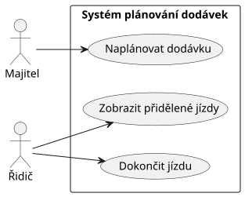

= Ukázkový dokument AsciiDoc
:toc:
:toc-title: Obsah
:toclevels: 3
:sectnums:

Tento dokument slouží jako jednoduchý příklad práce s AsciiDoc a PlantUML v projektu.

== Nadpisy

AsciiDoc používá znak `=` pro nadpisy.

[source,adoc]
----
= Název dokumentu
== Kapitola
=== Podkapitola
----

== Formátování textu

*Tučný text*

_Kurzíva_

`Kód nebo technický výraz`

== Seznamy

Nečíslovaný seznam:

* první položka
* druhá položka
* třetí položka

Číslovaný seznam:

. první krok
. druhý krok
. třetí krok

== Tabulka

[cols="1,2,2", options="header"]
|===
|ID |Název |Popis

|REQ-01
|Plánování dodávky
|Systém umožní naplánovat dodávku zákaznické objednávky.

|REQ-02
|Kontrola vozidla
|Systém zkontroluje dostupnost a kapacitu vozidla.
|===

== Poznámky

NOTE: Takto lze zvýraznit důležitou poznámku.

WARNING: Takto lze zvýraznit upozornění.

== PlantUML diagram

Zdroj diagramu je uložen v souboru:

`example-use-case.puml`

Z tohoto souboru se vygeneruje SVG obrázek:

`generated/example-use-case.svg`

Výsledný diagram lze potom zobrazit přímo v AsciiDoc dokumentu:

== Zdrojový kód diagramu

[source,plantuml]
----
@startuml

left to right direction

actor Majitel
actor Ridic as "Řidič"

rectangle "Systém plánování dodávek" {
    usecase "Naplánovat dodávku" as UC1
    usecase "Zobrazit přidělené jízdy" as UC2
    usecase "Dokončit jízdu" as UC3
}

Majitel --> UC1
Ridic --> UC2
Ridic --> UC3

@enduml
----

== Jak diagram upravit

. Otevřít soubor `example-use-case.puml`.
. Upravit PlantUML zdrojový kód.
. Zobrazit změny pomocí *PlantUML Preview*.
. Spustit *PlantUML: Export Current Diagram*.
. Zvolit formát `SVG`.
. Uložit výsledný soubor jako `generated/example-use-case.svg`.

AsciiDoc Preview potom automaticky zobrazí novou verzi diagramu.

== Závěr

Dokumentace je vytvářena v AsciiDoc a UML diagramy v PlantUML.

Zdrojové `.puml` soubory jsou textové a jejich změny lze jednoduše sledovat pomocí Gitu. SVG soubory slouží pouze jako vygenerovaný výstup pro zobrazení diagramů v dokumentaci.